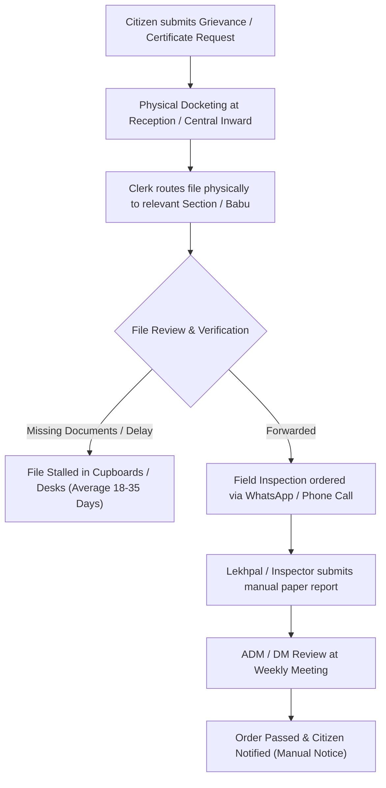
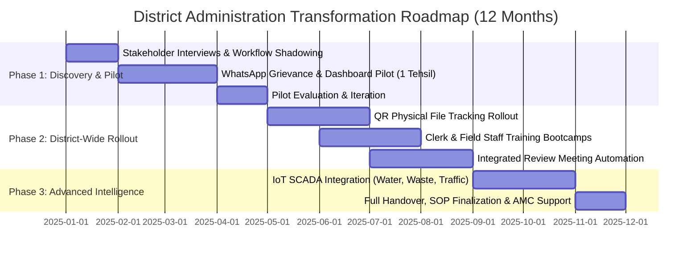

# Proposal & Executive Strategy: AI-Enabled District Administration Workflow
**Prepared for:** District Magistrate & Collectorate / Municipal Corporation  
**Candidate Submission:** Applied AI Engineer (LLM, Automation & Full-Stack) — Creditfix Group Assessment Task  
**Working Proof Prototype:** Vasudha Smart District & District Intelligence Command Centre

---

## Executive Summary

District Administration offices in India face unique operational realities: a massive volume of citizen interactions, paper-heavy workflows, fragmented communication via WhatsApp groups and phone calls, and an absence of a unified, real-time executive view for the District Magistrate (DM) and senior officers.

This proposal presents a **zero-to-100% pragmatic blueprint** to transform the District Collectorate into an AI-augmented, automated, and citizen-centric governance office without alienating existing staff or compromising sovereign citizen data.

---

## Part A: Understanding the Problem (Discovery & Ground Realities)

### 1. Key Stakeholders & Discovery Questions

| Stakeholder Group | Discovery Questions | Primary Concerns |
| :--- | :--- | :--- |
| **District Magistrate (DM / DC)** | What are your top 3 blindspots during Monday review meetings? Which departments generate recurring escalations? What key performance indicators (KPIs) matter most daily? | Lack of consolidated real-time data; delayed escalations; dependency on subordinate summary briefs. |
| **Additional District Magistrates (ADMs) & Sub-Divisional Magistrates (SDMs)** | Where are files delayed between tehsil offices and headquarters? Which citizen grievances get bounced between departments? | Inter-departmental finger-pointing; tracking field officer inspections; manual report compilation. |
| **Clerks, Babus & Peshi Staff** | Which registers do you maintain manually? How many times do you re-enter the same citizen details? What causes lost or untraceable physical files? | Fear of scrutiny or replacement; heavy typing load in English; complex legacy software interfaces. |
| **Field Officers (Lekhpal, Kanungo, BDOs, Sanitary Inspectors)** | How do you submit daily inspection reports? How do you communicate urgent field hazards or citizen disputes? | Reliance on unstructured WhatsApp groups; poor internet in remote rural pockets; lack of formal receipts. |
| **Citizens (Farmers, Urban Residents, Grievance Applicants)** | How many visits does it take to get a single certificate or grievance redressal? Do you receive clear updates on your application status? | Opaque processes; middleman exploitation; language barriers (complex administrative jargon). |

### 2. Workflow Mapping & Bottleneck Identification



#### The Four Fatal Bottlenecks:
1. **The Inward-Outward Black Hole:** Physical receipt stamping creates delays of 3–7 days before a file is even opened.
2. **Inter-Departmental Ping-Pong:** Grievances involving multiple departments (e.g., waterlogging requiring both Municipal Drainage and PWD) sit unowned because no single entity accepts responsibility.
3. **Unstructured Field Telemetry:** Photos, location coordinates, and inspection notes sent on informal WhatsApp groups are untraceable, non-searchable, and cannot be audited.
4. **Pre-Meeting Panic:** Senior officers spend hours before Monday review meetings manually compiling paper files and spreadsheets rather than analyzing systemic root causes.

### 3. Core Assumptions & Validation Plan

* **Assumption 1: Low digital literacy among clerical staff.**
  * *Validation:* Field interviews and a 2-day shadowing period observing clerical daily keystrokes.
  * *Mitigation:* Audio/voice input in colloquial Hindi, WhatsApp-native interfaces, and minimal-click UI.
* **Assumption 2: Reluctance to abandon physical files.**
  * *Validation:* Assess legal requirements for physical paper signatures vs. e-Sign / digital seals under Indian IT Act.
  * *Mitigation:* Hybrid QR-coded physical jacket tracking (computer-vision barcoding for physical paper files).
* **Assumption 3: Intermittent connectivity in rural tehsils.**
  * *Validation:* Network ping and latency logs across all blocks.
  * *Mitigation:* Offline-first Progressive Web Apps (PWA) with local SQLite / IndexedDB sync.

---

## Part B: Solution Design & Architecture

### 1. The 7 Highest-Impact Use Cases

1. **Multilingual AI Citizen Intake & Grievance Router (WhatsApp & Voice)**
   * *Justification:* 80% of citizens possess WhatsApp and smartphones. Voice notes in regional Hindi allow non-literate citizens to lodge grievances without paying middlemen. AI categorizes, geo-tags, and routes grievances to the precise nodal officer with an auto-generated token.
2. **Unified District Executive Command Centre (Our Prototype)**
   * *Justification:* Gives the DM and Municipal Commissioner a single bird's-eye view of all district systems (irrigation, waste, traffic, water, flood, environment, incidents) with simulated live telemetry.
3. **Physical File & Dossier QR Tracking (Computer Vision)**
   * *Justification:* Every physical file gets a unique QR barcode. Clerks scan the file with their phone when passing it to another desk. The system automatically creates a chain-of-custody audit trail, flagging files stalled >48 hours.
4. **Pre-Review Meeting Automated Brief Generator (AI Synthesis)**
   * *Justification:* Automatically aggregates weekly department performance, overdue SLA tickets, and unfulfilled DM directives into an executive 3-page briefing pack every Sunday evening.
5. **Smart Actuator & IoT SCADA Verification (Human-in-the-Loop)**
   * *Justification:* Allows authorized officers to remotely monitor and control municipal actuators (pumps, traffic lights, flood gates) with built-in safety interlocks.
6. **Field Inspection & Geo-Tagged Verification Assistant**
   * *Justification:* Lekhpals and sanitary inspectors capture timestamped, geo-tagged photos and speech-to-text notes on mobile, automatically updating central ticket statuses.
7. **Proactive Citizen WhatsApp Status Updates & Resolution Verification**
   * *Justification:* Citizens receive automated WhatsApp updates ("Your file was received by Officer Sharma"). When marked resolved, the citizen must confirm satisfaction with a 1-tap rating before the ticket is officially closed.

### 2. Pragmatic System Architecture

```
                    ┌────────────────────────────────────────────────────────┐
                    │               CITIZEN & FIELD TOUCHPOINTS              │
                    │  WhatsApp Bot (Meta Cloud API)  •  PWA  •  Toll-Free   │
                    └──────────────────────────┬─────────────────────────────┘
                                               │
                                               ▼
┌────────────────────────────────────────────────────────────────────────────────────────────┐
│                                   API GATEWAY & AUTH LAYER                                 │
│  FastAPI / Node.js • Aadhaar/e-Pramaan Auth • Role-Based Access Control (RBAC)             │
└──────────────┬───────────────────────────────┬──────────────────────────────┬──────────────┘
               │                               │                              │
               ▼                               ▼                              ▼
┌──────────────────────────────┐┌──────────────────────────────┐┌─────────────────────────────┐
│    CORE OPERATIONAL LAYER    ││   AI & INTELLIGENCE LAYER    ││     SCADA & IoT LAYER       │
│  PostgreSQL (Relational/GIS) ││  Self-Hosted Llama-3 / vLLM  ││  MQTT Broker (EMQX)         │
│  File Tracker & Ticket SLAs  ││  LangChain / Semantic Router ││  LoRaWAN Network Server     │
│  Audit Logs & Action History ││  Whisper Hindi ASR (Voice)   ││  Edge RTU Actuators         │
│  Department Master Registry  ││  RAG Knowledge Retrieval     ││  Telemetry Time-Series (DB) │
└──────────────┬───────────────┘└──────────────┬───────────────┘└─────────────┬───────────────┘
               │                               │                              │
               └───────────────────────┬───────┴──────────────────────────────┘
                                       │
                                       ▼
                    ┌────────────────────────────────────────────────────────┐
                    │         EXECUTIVE COMMAND CENTRE (DASHBOARD)           │
                    │  React.js • Tailwind CSS • Leaflet GIS • Recharts      │
                    │  (DM, Municipal Commissioner & HoD Unified Interface)  │
                    └────────────────────────────────────────────────────────┘
```

### 3. Clear Demarcation: Where AI / LLM is Needed vs. Where Automation is Enough

| Workflow Component | Technology Used | Why Simple Automation is Sufficient | Why LLM / AI Agent is Genuinely Needed |
| :--- | :--- | :--- | :--- |
| **SLA Escalations & Due Date Reminders** | **Deterministic Automation** | Cron jobs and threshold rules (e.g., if days > 7, escalate to SDM). | LLMs are unnecessary and introduce hallucination risks in deterministic rule engines. |
| **Grievance Triage & Categorization** | **LLM (Multilingual Classifier)** | Keyword matching fails on colloquial complaints (e.g., "nal se ganda paani aa raha hai" vs "water supply issue"). | LLM understands nuances, extracts intent, estimates urgency, and maps to the correct department. |
| **File Movement Audit Trail** | **Deterministic Automation** | Scanning QR codes and updating timestamps in PostgreSQL. | Deterministic databases are tamper-proof and mathematically reliable. |
| **Voice-to-Text Citizen Complaints** | **AI (Whisper + Translation)** | Cannot be done with regex or rule logic. | Fine-tuned Whisper models transcribe regional dialects (Bhojpuri, Awadhi, Hindi) into structured text. |
| **Pre-Meeting Department Briefing** | **LLM (Summarization Agent)** | Pure aggregation produces 500-page raw tables officers won't read. | LLM synthesizes trends, highlights chronic defaulters, and drafts actionable agenda items. |
| **Actuator Control (Pumps / Gates)** | **Deterministic SCADA + Logic** | Physical safety limits (voltage, water levels, timers) must be hard-coded. | AI should only recommend, NEVER directly trigger high-power actuators without human confirmation. |

---

## Part C: Zero-to-100% Implementation Roadmap



### Milestone & Effort Breakdown

* **Phase 1: Discovery & Single-Tehsil Pilot (Months 1–3)**
  * *Team:* 1 Lead AI Engineer, 1 Full-Stack Dev, 1 On-Ground Field Coordinator.
  * *Deliverable:* WhatsApp Grievance Intake + Collectorate Pilot Dashboard in Tehsil Sadar.
  * *Success Metric:* 500 grievances routed with >90% categorization accuracy; average intake time reduced from 45 mins to 2 mins.
* **Phase 2: District Rollout & Physical File Tracking (Months 4–7)**
  * *Team:* 2 Full-Stack Devs, 1 DevOps Engineer, 2 District Trainers.
  * *Deliverable:* QR-barcode tracking on all collectorate physical files; all 6 tehsils onboarded.
  * *Success Metric:* 0 lost physical files; file transit time between desks reduced by 40%.
* **Phase 3: Scale, IoT SCADA & Review Automation (Months 8–12)**
  * *Team:* 1 AI/ML Engineer, 1 SCADA Specialist, 1 Full-Stack Dev.
  * *Deliverable:* Integration with municipal IoT sensors; automated Sunday executive pre-review briefing packs.

---

## Part D: Risks, Security and Compliance

### 1. Data Privacy & Sovereign Hosting
* **Government Cloud Hosting:** Deploy strictly on **NIC (National Informatics Centre) Cloud (MeghRaj)** or MeitY-empaneled sovereign data centres (AWS Mumbai / Azure Pune). Zero citizen data leaves Indian territory.
* **Aadhaar / PII Masking:** Automated regex and redaction pipelines to mask Aadhaar numbers, bank account numbers, and phone numbers in public logs.
* **Role-Based Access Control (RBAC):** Strict tiering: DM/ADM (Full District Read/Write), Department Heads (Departmental Scope), Clerks (Task Scope), Field Staff (Assigned Task Only). Immutable PostgreSQL write-only audit logs.

### 2. Controlling AI Risks (Hallucination, Bias, Wrong Routing)
* **Confidence Scoring & Fallback:** Every AI categorization generates an illustrative confidence score (0–100%). If confidence < 80%, the grievance is flagged to a human triage clerk.
* **Deterministic Guardrails:** LLM outputs must strictly conform to JSON schemas. Freeform hallucinated text cannot modify database states.
* **Closed-Loop Resolution:** An officer cannot close a ticket unilaterally. The citizen receives an automated WhatsApp verification: "Officer Sharma marked this resolved. Is your problem solved? [Yes] [No]".

### 3. Overcoming Resistance to Change & Low Digital Literacy
* **"Babu-Friendly" Workflow Design:** Keep physical files, but add QR stickers. Clerks don't write complex software updates—they simply tap "Scan & Receive" on a dedicated mobile app.
* **Voice & Vernacular UI:** Voice prompts in Hindi so officers can record inspection findings while driving between field sites.
* **Incentive Alignment & Leaderboards:** Public recognition in Monday meetings for the top 3 fastest-resolving tehsils and best-performing clerks.

---

## Part E: How to Pitch to the District Magistrate

### The 2-Minute Jargon-Free Pitch

> *"Good morning, Sir. Every Monday during review meetings, your department heads bring stacks of paper reports. When a citizen's tap has no water or a drainage canal overflows, you only hear about it after public protests or when the file lands on your desk 3 weeks later.*  
>  
> *We are not proposing to replace your staff or discard your physical files. We are giving you a **Unified District Intelligence Command Centre**.*  
>  
> *Citizens lodge grievances directly through WhatsApp in colloquial Hindi in 60 seconds. Our system categorizes and routes it to the exact Sub-Divisional Magistrate with a hard deadline. Physical files get a simple QR code—if a file sits on a clerk's table for more than 48 hours without movement, your dashboard alerts you automatically.*  
>  
> *You don't need to spend Sundays reading 500 pages of spreadsheets. When you walk into Monday's meeting, your screen highlights the exact 3 bottlenecks requiring your order.*  
>  
> *Let us run a zero-risk, 60-day pilot in just one Tehsil at zero disruption to your daily operations."*

### Handling Senior Officer Objections

1. **Objection:** *"We already have CPGRAMS / IGRS portal."*
   * *Response:* "Sir, IGRS is an intake repository, not a workflow engine. Officers still chase status on WhatsApp and paper files. Our platform sits on top of IGRS, automating the routing, field verification, and Sunday review synthesis."
2. **Objection:** *"It is not secure. Government data might leak."*
   * *Response:* "Sir, the platform is hosted entirely on sovereign MeitY-empaneled government servers with end-to-end encryption. In fact, it is infinitely more secure than current government communications happening over unencrypted personal WhatsApp groups."
3. **Objection:** *"Our field staff will not use it; they are not tech-savvy."*
   * *Response:* "Sir, that is why we built it on WhatsApp and Voice. If a Lekhpal knows how to send a voice note on WhatsApp, he already knows 100% of how to use our system. No new apps to learn, no typing in English."

---

## Part F: Working Proof (The Delivered Prototype)

As proof of execution, we built the **Vasudha Smart District & District Intelligence Command Centre**:
* **15 Complete Navigation Modules**
* **Unified Command Overview Dashboard** with 10 Executive KPI cards
* **Interactive GIS Geospatial Map** (Leaflet OpenStreetMap) tracking 100 IoT devices, municipal vehicles, and zone buffers
* **8 Smart City Sector Modules:** Irrigation SCADA, Waste Fleet Tracking & Route Optimisation, Adaptive Traffic Signals, Water Quality SCADA, CAAQMS Air Quality, Flood Early Warning, Energy & Street Lighting, and Civil Infrastructure Health
* **AI Intelligence & Forecasting Centre:** Multi-horizon predictive curves (1h, 3h, 6h, 12h, 24h), anomaly detection, and predictive maintenance
* **Conversational AI Copilot:** Pre-configured with executive district query logic
* **Administrative Incident Dossiers:** Complete lifecycle management with audit trails and SOP recommendations
* **Central Simulation Engine:** Controlled real-time telemetry streaming with pause/resume and demo reset capabilities

